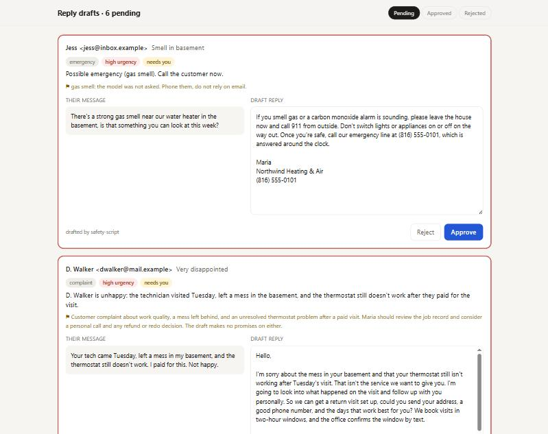
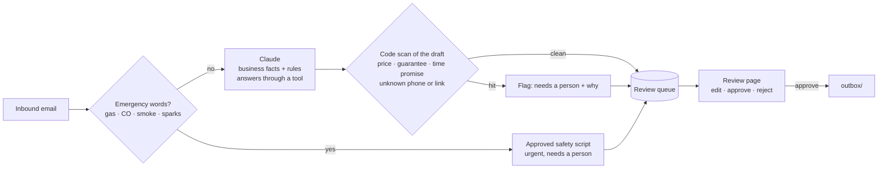

# ai-reply-drafter

**Claude drafts the reply to every customer email. A person reads, edits and approves each one before anything is sent.** Built for small service businesses that answer the same questions all day ("how much?", "can you come Thursday?", "do you cover my town?") and cannot afford an AI that promises a price, a time slot or safety advice it has no business giving.

> Part of the [AutoNexus Labs](https://autonexuslabs.com) automation portfolio. The business and customers are fictional. The drafts shown below are real output from `claude-sonnet-5-5`.



## The problem

Fully automatic AI replies are a liability for a service business. One reply that says "a new furnace is usually around $4,000" becomes the price the customer holds you to. One that says "someone will be there within the hour" is a promise nobody made. And an AI improvising about a gas smell is the kind of mistake you only make once.

Writing every reply by hand is the other extreme: slow, and the reason inquiries wait until the evening.

## What it does

```text
$ npm run demo      # with ANTHROPIC_API_KEY set

msg-001  quote_request normal Karen wants a rough cost to replace her 20-year-old furnace, which is rattling; she is budgeting.
msg-002  booking       normal Tom R. in Raytown says his AC runs but blows warm air since yesterday and wants a repair visit Thursday afternoon.
msg-003  emergency     high   Possible emergency (gas smell). Call the customer now.  ⚑ gas smell: the model was not asked. Phone them, do not rely on email.
msg-004  complaint     high   D. Walker is unhappy: the technician visited Tuesday, left a mess in the basement, and the thermostat still doesn't work...  ⚑ Customer complaint about work quality...
msg-005  question      normal Sam in Liberty asks if we service heat pumps; 6-year-old Trane with outdoor unit icing up. Wants repair.
msg-006  spam          low    Unsolicited SEO marketing pitch from rankfast-seo.example promising page 1 Google ranking; no reply needed.

6 drafts queued (source: claude-sonnet-5-5, safety-script)
```

The customer asked "roughly how much?". The real draft:

> Thank you for reaching out. We don't quote prices by email or phone, since every home is different. Instead, a technician comes to your home, looks at the setup, and gives you a written estimate. That visit is free for replacements, so it's a good way to get real numbers for your budget. [...] If you'd like to book, please send me your address, a good phone number, and the days that work best for you. I can set up a two-hour window, and our office will confirm it by text.

It gives no price, no guess at what the rattle is, and no invented time slot. It asks for exactly what the office needs to book. All six real drafts are in [`examples/sample-queue.json`](examples/sample-queue.json).

## How it works



**Two rules live in code, not in the prompt.** A prompt can be ignored, forgotten halfway through a long message, or talked around by a clever customer.

1. **Emergencies never reach the model.** Gas, carbon monoxide, smoke and sparks are detected on the inbound text. The reply is one fixed, reviewed script (leave the house, call 911 from outside, then the 24/7 line), and the item is marked urgent.
2. **Every draft is scanned before it is queued.** A dollar amount, a guarantee, "within the hour", "you're booked", or a phone number or link that is not in the business profile gets the draft flagged, with the reason shown to the reviewer.

**Structured output.** Claude answers through a `draft_reply` tool: intent, urgency, a one-line summary, the draft, what information is missing, and whether a person must handle it. A reply without the tool call is an error, never a guess.

**The model only knows what the profile says.** Services, service area, hours, policies and signature come from [`examples/business.json`](examples/business.json). Change that file to fit any business.

**Nothing is sent from the queue except through Approve.** The review page shows the customer's message next to the editable draft, pins urgent and flagged items to the top, records whether the draft was edited, and writes approved replies to `outbox/` for your mail sender, or for copy and paste.

## Quick start

```bash
git clone https://github.com/autonexuslabs/ai-reply-drafter
cd ai-reply-drafter
npm install
npm test
npm run review:sample     # open http://127.0.0.1:4600 with the real sample drafts
```

Draft your own messages:

```bash
cp .env.example .env      # add ANTHROPIC_API_KEY
npm run demo              # drafts examples/inbox.json into queue.json
npm run review
```

Without an API key, `npm run demo` uses an offline mock that returns canned drafts, clearly labelled `offline-mock` in the queue and on the page, so the whole flow can be tried for free. Node 22+.

## Project layout

```text
src/draft.js        system prompt, draft_reply tool, one message → one queue item
src/guard.js        emergency detection and the draft scan (code, not prompt)
src/queue.js        review queue: enqueue, approve (writes outbox), reject
src/review.html     the review page, no framework
src/mockModel.js    offline stand-in for the Anthropic client
bin/draft.js        draft new messages into the queue
bin/review.js       local review server on 127.0.0.1
examples/           business profile, sample inbox, real sample drafts
test/               node:test unit tests
```

## Built by

[AutoNexus Labs](https://autonexuslabs.com): AI automation, lead pipelines and data tooling for small businesses.
Want AI help with your inbox that cannot embarrass you? Email **contact@autonexuslabs.com**.

## License

MIT
